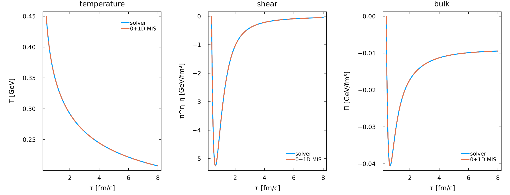
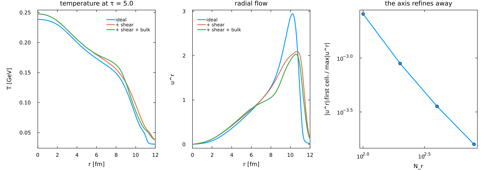
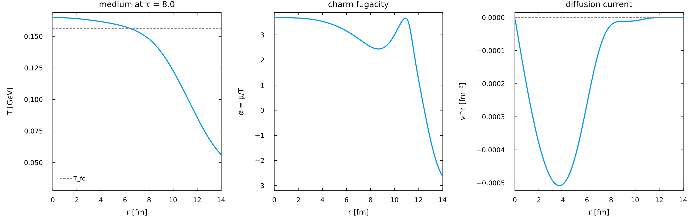

# Fluidum 1+1D viscous hydrodynamics — worked examples

Three runnable setups for `matrix1d_visc!` and `matrix1d_visc_HQ!` (`src/Matrix/1d_viscous_cilindrical.jl`,
`1d_viscous_HQ_cilindrical_fugacity.jl`), the cylindrical, boost-invariant Milne solvers for

```
phi = (T, u^r, pi^phi_phi, pi^eta_eta, Pi)              viscous_1d()
phi = (T, u^r, pi^phi_phi, pi^eta_eta, Pi, alpha, nu^r) HQ_viscous_1d()
```

**This is the production path.** LangevinPaper1, AttractorHydro and SpectraDiagnostic all stand on
these two kernels — and until 2026-09-14 the package shipped no examples for them at all, while the
2+1D sector (which is on no manuscript's production path) had three. Each produces a figure in
`figures/`. They are written to be **copied and edited**.

⚠ **`Plots` is not a dependency of this package**, the same as for `examples/2p1d_viscous/`. These
files `using Plots`, and it resolves through the shared default environment; a fresh clone must add
it. Nothing in `src/`, `test/` or `bench/` needs it.

```sh
julia --project=Julia Julia/Fluidum.jl/examples/1p1d_viscous/01_first_run.jl
julia --project=Julia Julia/Fluidum.jl/examples/1p1d_viscous/02_fireball_and_resolution.jl
julia --project=Julia Julia/Fluidum.jl/examples/1p1d_viscous/03_charm_current.jl
```

| | what it shows | time |
|---|---|---|
| **01** the first run | the whole API — layout, discretisation, fluid properties, IC, driver, readout — on the one configuration with a closed-form answer: a radially uniform state must integrate the 0+1D Israel–Stewart equations, which it does to 1e-13 | 19 s |
| **02** a fireball, the axis and resolution | the sector ladder (ideal → +shear → +bulk) from one initial condition; the measurement that `u^r → 0` at the axis and does so faster under refinement, which is what an ODD parity buys; and the self-convergence order, which is ≈1 because `basicupwinding` is first order | 26 s |
| **03** the charm current | what the solver is *for*: `alpha` and `nu^r` on a cooling fireball, the current **built** from a gradient that starts at zero, and the charm-number integral over Cauchy slices whose drift **halves** with each refinement | 100 s |

Times are the suite baseline (`Julia/Projects/suite_baseline.toml`), recorded 2026-09-14 — the
first time anything ran these. The suite runs them all with
`julia --project=Julia Julia/Projects/run_suite.jl examples --only 1p1d_viscous`.

### 01 — the first run

A radially uniform state must integrate the 0+1D Israel–Stewart equations, and does, to 1e-13. The
solver and the closed form are drawn on top of each other; where you can see two lines, you are
looking at the line width.



### 02 — a fireball, the axis, and resolution

Left: the sector ladder from one initial condition — ideal, +shear, +shear+bulk. Both dissipative
sectors RESIST, so both reduce the radial flow; a sector that increased it would be a sign error,
and that is the cheapest check this ladder buys. Right: `|u^r|` at the axis against resolution, the
measurement that the ODD parity is doing its job.



### 03 — the charm current

What the solver is *for*. `ν^r` starts identically zero and is **built** by the gradient that
cooling and radial flow create; it vanishes at the axis by parity and where `α` is flat.



## Conventions, and the one that has caught people

`pietaeta` is the **mixed** Milne component `pi^eta_eta = tau^2 pi^{eta eta}`, not `pi^{eta eta}`;
`piphiphi` is the mixed `r^2 pi^{phi phi}`. Same mixed convention `viscous_2d` uses for
`piyy`/`pizz`. The Navier–Stokes fixed points on a Bjorken background are

```
pi^eta_eta -> -4 eta/(3 tau)      pi^phi_phi -> +2 eta/(3 tau)      Pi -> -zeta/tau
```

and the relaxation is **plain Israel–Stewart** — no `delta_pipi`, no `tau_pipi`, no `lambda_piPi`.
Example 01 pins all of that to 1e-13; a `delta_pipi = (4/3) tau_pi` term of the kind FiVoHydro
carries would move `pi^eta_eta` by ~20 % on the state it reaches, and it is measurably absent. That
difference is why a Fluidum-vs-FiVoHydro comparison must be run with FiVo's `delta_pipi` switched
off to be like-for-like (`Julia/Projects/FiVoFluidumComparison/COMPARISON_2P1D.md` §3).

> **2026-10-13:** the relaxation now carries **δ_ππ = (4/3) τ_π** by default (RS; the DNMR value, which the
> production `:MIS` kernel always had), behind `FLUIDUM_DELTA_PIPI` (`0` = the plain Israel–Stewart described
> above, bit for bit). Example 01's reference follows the switch; a FiVoHydro comparison now runs FiVo at its
> default `deltaShear_factor = 4/3` (`Projects/FluidumValidation/MATRICES_PROGRAMME.md`, P2b).

## The three things that bite hardest here

1. **`r = 0` is a SYMMETRY AXIS, not a boundary.** `viscous_1d` declares `ur` **odd** there and
   every other field **even**. Getting that wrong does not crash anything — it puts a kink in the
   first few cells that reads as a physical feature. Example 02 measures `|u^r|` in the first cell
   against its peak and shows it falling monotonically under refinement; a parity error leaves it
   flat in `N`.

2. **The charm sector dies on a SHARP fireball edge, and the medium does not.** Example 03 was
   first written with the Woods–Saxon width `a = 0.6` of example 02, and the solve aborted at
   `tau ≈ 3.3–4.2` with *"dt was forced below floating point epsilon"*: `alpha` runs away
   (it reached **−729**) where the charm density underflows, and the `alpha` row's time coefficient
   `u^tau dn_da = u^tau n` vanishes with it, leaving the `dmn_eps` regulator *as* the coefficient.
   It uses `a = 2.0` for that reason, and §E2 of `Projects/FluidumValidation/bench_fluidum_full.jl`
   maps the failure over `a ∈ (2.0, 1.0, 0.6, 0.3) × T_min ∈ (0.02, 0.05)`. The 2-D solver has the
   same failure on a real event, where three alternative regulators were tried and none worked
   (`COMPARISON_2P1D.md` §37.2). **The root cause is the `alpha` runaway, not the regulator** — do
   not read "it works at `a = 2`" as "it works".

3. **Julia soft scope kills accumulators, and it killed one of these examples while it was being
   written.** `prev = drift` inside a *top-level* `for` creates a new local every iteration, so
   example 03's convergence-ratio column printed "—" forever and looked like a formatting choice.
   Put the loop in a function. (`CLAUDE.md`, trap #1.)

## And one about reading the numbers

**Quote `|pi|/e` above freeze-out only.** In the dilute tail `e → 0` while `pi` relaxes on a finite
clock, so the ratio there is a property of the vacuum, not of the fluid, and it runs past 1. Example
02 prints 0.08 with a `T > T_fo` mask and 1.96 without — a factor 24 from the cut alone.

## Where the gates live

These are **examples, not gates**.

| | |
|---|---|
| `Julia/Fluidum.jl/test/test_1p1d_viscous.jl` | the fast testset, run by `Pkg.test()` — layout and parities, closed-form characteristic speeds, the shear closure, Bjorken, and the derived-matrix control (99 assertions, ~4 s) |
| `Julia/Fluidum.jl/bench/bench_1p1d_viscous.jl` | the solver against closed forms: the MIS front, the sound cone, `A_t` conditioning, the derivation control, Bjorken, the axis ladder and self-convergence (12 gates, ~25 s) |
| `Julia/Projects/FluidumValidation/bench_fluidum_full.jl` | the wide audit — every matrix entry point, semi-analytic references, cross-checks between formulations. 24 pass / 7 **declared** known failures |
| `Julia/Projects/FluidumValidation/bench_fluidum_attractor.jl` | the charm sector's audit. 23 pass / 4 **declared** known failures, the elliptic `c_M` branch among them |

```sh
julia --project=Julia Julia/Fluidum.jl/bench/bench_1p1d_viscous.jl
```

**These same configurations are compared against FiVoHydro.jl**, cell for cell, in
`Julia/Projects/FiVoFluidumComparison/compare_examples_1p1d.jl` (15/15) and written up in
`COMPARISON_1P1D.md`: on Bjorken the two codes agree to the ħc floor once FiVo's operator split is
extrapolated away, and on the fireball their difference converges at roughly first order in every
field and every sector.

The 2+1D examples are in [`../2p1d_viscous/`](../2p1d_viscous/README.md).
