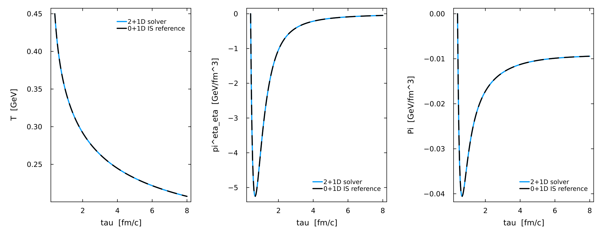
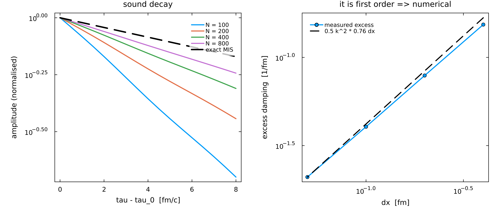
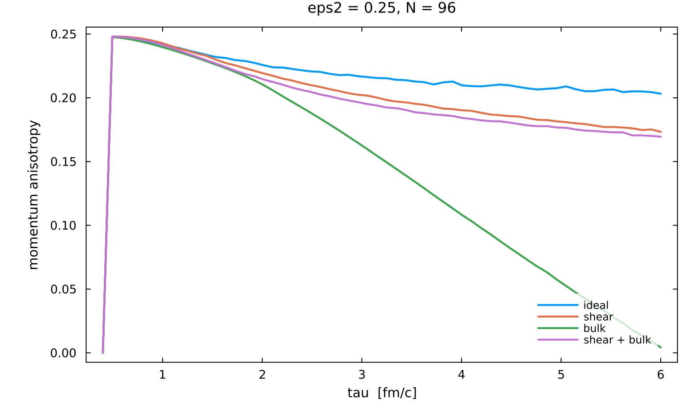

# Fluidum 2+1D viscous hydrodynamics — worked examples

Three runnable setups for `matrix2d_visc!` (`src/Matrix/2d_viscous.jl`), the transverse-Cartesian,
boost-invariant Milne solver for

```
phi = (T, u^x, u^y, pi^{yy}, pi^{zz}, pi^{xy}, Pi)
```

Each produces a figure in `figures/`. They are written to be copied and edited.

The examples need `Plots` in the active environment; it is not a dependency of Fluidum. From the
package root:

```sh
julia --project=. examples/2p1d_viscous/01_first_run.jl
julia --project=. examples/2p1d_viscous/02_resolution_and_numerical_viscosity.jl
julia --project=. examples/2p1d_viscous/03_elliptic_fireball.jl
```

| | what it shows |
|---|---|
| **01** the first run | the whole API, and the one configuration with a closed-form answer: a uniform state must integrate the 0+1D Israel–Stewart equations |
| **02** resolution and numerical viscosity | the sound attenuation against the MIS dispersion relation, and the measurement that the first-order upwind scheme's own diffusivity is `D_num ≈ 0.75 Δx`, comparable to the physical `Γ_s` at typical resolutions |
| **03** an elliptic fireball | the sector ladder on a deformed Woods–Saxon, the causal envelope measured from the characteristic matrix, and where the run leaves it |

### 01 — the first run

A transversely uniform state must integrate the 0+1D Israel–Stewart equations.



### 02 — resolution and numerical viscosity

The sound attenuation against the MIS dispersion relation, and the measurement that the
first-order upwind scheme's own diffusivity is `D_num ≈ 0.75 Δx`, comparable to the physical `Γ_s`
at typical resolutions. This is the figure to look at before choosing a grid.



### 03 — an elliptic fireball

The sector ladder on a deformed Woods–Saxon, the causal envelope measured from the characteristic
matrix, and where the run leaves it.



⚠ **Do not read the green `bulk` curve as physics.** It drives the momentum anisotropy to ~0 by
τ = 6. That collapse is a resolution artefact at this grid, not what bulk viscosity does, and
refinement removes it. The script scans the Woods–Saxon surface width against `dx` (`a_surf/dx`).
A scan with a temperature pedestal points to the width of the ζ Lorentzian in x against `dx`,
`FWHM_x(ζ)/dx`, with a threshold near 1.4, as the controlling variable. At N = 96 on this box the
run sits near that threshold.

## Conventions

`pi^{zz}` is the mixed Milne component `pi^eta_eta = tau^2 pi^{eta eta}`, not `pi^{eta eta}`;
`pi^{yy}` is the Cartesian `pi^y_y`. `viscous_1d` uses the same mixed convention for
`piphiphi`/`pietaeta`. The Navier–Stokes fixed points on a Bjorken background are

```
pi^eta_eta -> -4 eta/(3 tau)      pi^y_y -> +2 eta/(3 tau)      Pi -> -zeta/tau
```

The relaxation is Israel–Stewart plus `delta_pipi pi theta`, with `delta_pipi = (4/3) tau_pi` (the
DNMR value) by default. `FLUIDUM_DELTA_PIPI=0` gives plain Israel–Stewart. There is no `tau_pipi`
and no `lambda_piPi`. Example 01's reference follows the switch. When comparing with another code,
match its `delta_pipi`.

## The derived matrix

By default `matrix2d_visc!` and the 10-field `matrix2d_visc_HQ_BG!` use the matrix generated by
`deriv/derive_2p1d_viscous.wls`. `FLUIDUM_2D_DERIVED=0` selects the legacy hand-written matrix (with
a warning), to reproduce older results only. The legacy matrix has ten wrong entries in its two
shear rows: its `pi^{xy}` row is driven by the one-sided velocity gradient `-2 eta d_x u^y` where
Israel–Stewart asks for `-2 eta sigma^{xy} = -eta (d_x u^y + d_y u^x)`. As a result it

* agrees with the derived matrix for irrotational transverse flow, so smooth fireballs started from
  rest are nearly unaffected;
* is wrong by `-2 eta omega_xy` wherever the flow carries vorticity: a rigid rotation, which must
  generate no shear, generates `pi^{xy}` at the full Navier–Stokes rate;
* has an anisotropic characteristic structure: the transverse shear channel propagates at
  `sqrt(2 C_s)` along x and at 0 along y, instead of `sqrt(C_s)` in every direction.

The derived matrix is not slower (173 ns against 197 per cell evaluation).

## Tests and benchmarks

| | |
|---|---|
| `test/test_2p1d_viscous.jl` | the fast testset, run by `Pkg.test()`: closed-form characteristic speeds, isotropy, the Bjorken limit |
| `bench/bench_2p1d_viscous.jl` | the solver against closed forms: Bjorken, the MIS sound dispersion, ideal Gubser, 2-D against the 1-D cylindrical solver |
